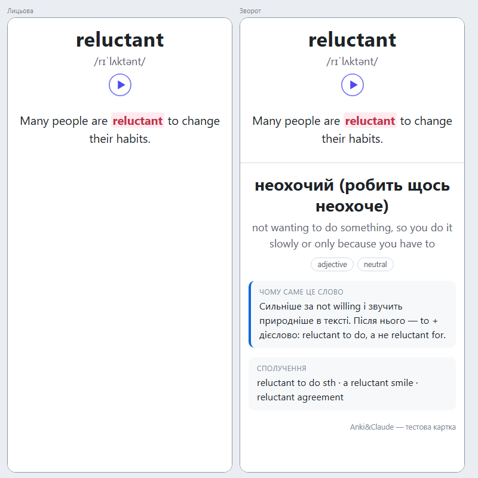
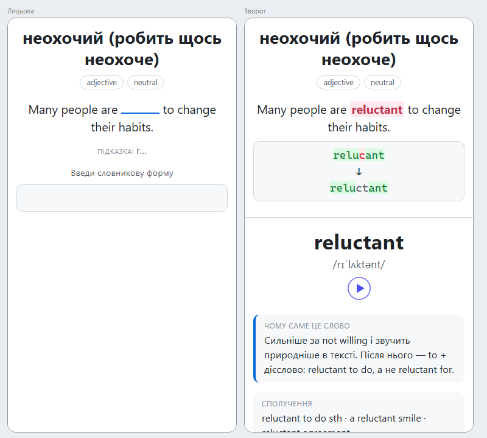
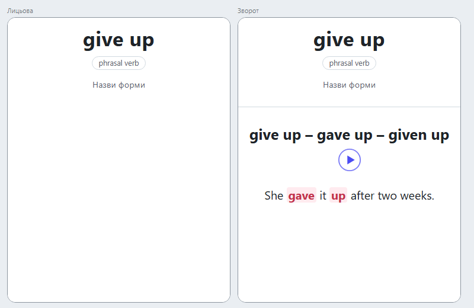
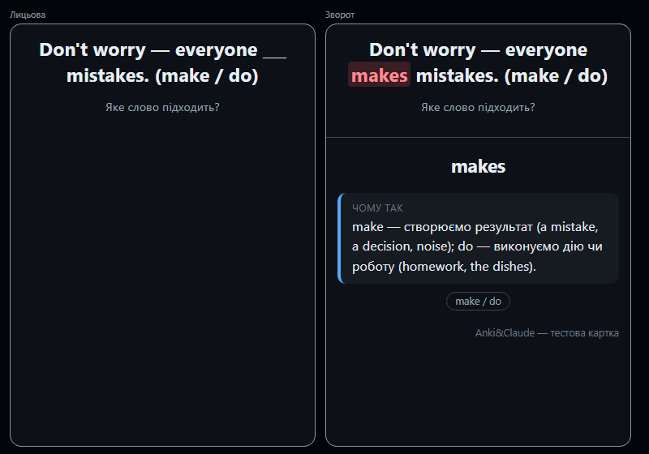
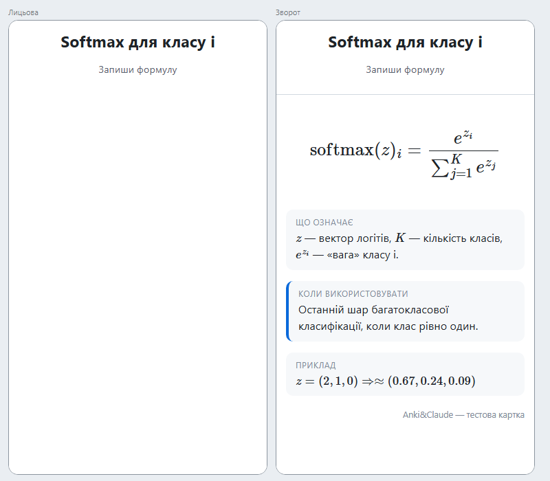
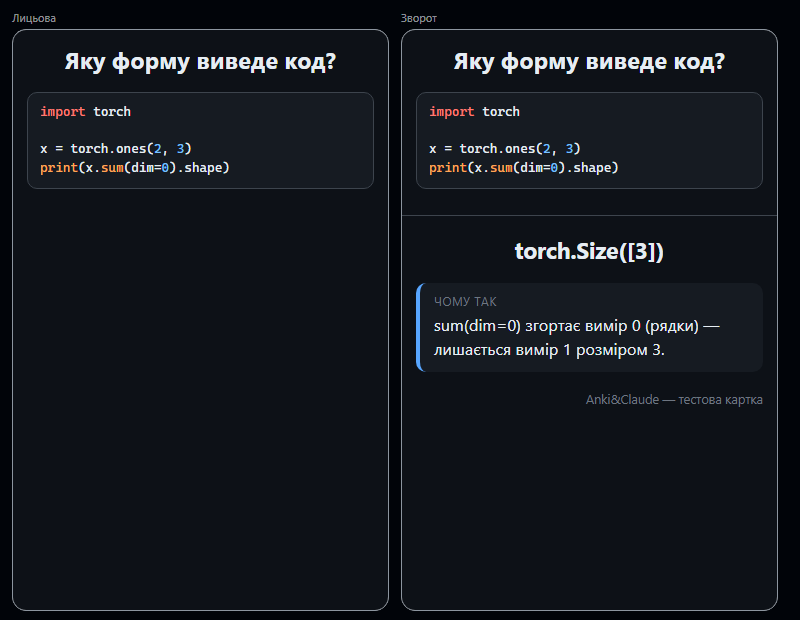

# Anki&Claude

Плагін для [Claude Code](https://code.claude.com), який створює, покращує й організовує картки [Anki](https://apps.ankiweb.net)
так, щоб навчання було максимально ефективним: інтервальні повторення, активне пригадування, навчання в контексті.
Кидаєш Claude текст, PDF лекції, код чи слова з серіалу — отримуєш превʼю якісних карток і додаєш їх одним «так».

<p>
  
  
</p>

## Що вміє

| Команда | Що робить |
|---|---|
| `/anki-add <текст або тема>` | картки з будь-чого |
| `/anki-file <шлях>` | картки з файлу: PDF лекції, конспект, Markdown |
| `/anki-vocab <слова або текст>` | англійські слова; з тексту сам обирає корисні під твій рівень |
| `/anki-distinct <make/do>` | картки на розрізнення схожих слів |
| `/anki-code <файл або фрагмент>` | картки з коду: ідіоми, API, концепції |
| `/anki-leeches` | розбір проблемних карток: чому забуваються і як виправити |
| `/anki-stats` | коротка статистика і що підтягнути |
| `/anki-fix <пошук Anki>` | покращення наявних карток за правилами якості |
| `/anki-promote` | розморожування відкладених карток слів |

Можна й без команд: «зроби картки з цього конспекту», «додай в Anki слова з цього уривку».
Прапорці: `--auto` — додати без підтвердження, `--known` — слова вже знайомі (картка UA→EN одразу активна).

**Як це працює:**

1. Claude читає матеріал, складне спершу коротко пояснює.
2. Відбирає найважливіше (за замовчуванням до 15 карток) і пише картки за [13 правилами якості](plugins/ankiclaude/skills/anki-cards/references/quality-rules.md): одна картка — один факт, без списків, з контекстом, з картками «чому?» і на розрізнення.
3. Перевіряє дублікати і показує превʼю таблицею: «додати все / змінити № … / видалити № … / зробити активними № …?».
4. Додає пакетом у потрібні колоди з тегами і синхронізує з AnkiWeb.

## Типи карток

| Тип | Для чого |
|---|---|
| **Concept** | питання → коротка відповідь + «чому так» + приклад |
| **Cloze** | означення й факти в реченні з пропуском |
| **Formula** | формула (MathJax) + що означають члени + коли застосовувати |
| **Code** | «що виведе / що вставити» з підсвіткою синтаксису |
| **Vocab** | англійське слово: до трьох карток з однієї нотатки |
| **Distinction** | make/do, say/tell…: речення з пропуском і поясненням |

**Vocab** дає три картки:

- **EN→UA (розпізнавання).** Слово, IPA, озвучка і випадковий з 2–3 живих прикладів, де слово виділене. На звороті переклад, пояснення англійською, «чому саме це слово» (типова помилка українців) і сполучення.
- **UA→EN (продукування)**, лише для активних слів. Переклад і приклад із пропуском, вводиш словникову форму. Ця картка спершу призупинена й вмикається сама, коли EN→UA закріпиться (інтервал ≥ 3 днів).
- **Форми** (go – went – gone), за бажанням. Вмикається, коли закріпиться UA→EN.

<p>
  
  
</p>
<p>
  
  
</p>

Шаблони однаково працюють в Anki на комп'ютері й в AnkiDroid: випадковий приклад і на звороті той самий,
введення відповіді, нічна тема, вузький екран телефона.

## Встановлення

### 1. Anki і AnkiConnect

1. Встанови [Anki](https://apps.ankiweb.net) (25.x або новішу).
2. В Anki: **Інструменти → Додатки → Отримати додатки**, код **`2055492159`** (AnkiConnect). Перезапусти Anki.
3. Увійди в AnkiWeb: кнопка **Синхронізувати** (якщо вчиш і на телефоні).

Anki має бути відкрита, коли працюєш з плагіном.

### 2. uv

Плагін запускає свій сервер через [uv](https://docs.astral.sh/uv/) — він сам завантажить потрібний Python.

```bash
# Windows (PowerShell)
powershell -ExecutionPolicy ByPass -c "irm https://astral.sh/uv/install.ps1 | iex"
# macOS / Linux
curl -LsSf https://astral.sh/uv/install.sh | sh
```

### 3. Плагін

```bash
claude plugin marketplace add denysfreiuk/anki-claude
claude plugin install ankiclaude@ankiclaude --config root_deck=Study
```

`root_deck` — коренева колода, під якою плагін створить свої (`Study::English::EN-UA`, `Study::ML`…).
Відкрий **новий** чат Claude Code і напиши «перевір з'єднання з Anki». Перший запуск встановлює залежності (~10–30 с).
Потім «налаштуй колоди і типи нотаток» — або просто почни з `/anki-add`, Claude зробить це сам.

### 4. Налаштування

Змінити: `claude plugin configure ankiclaude@ankiclaude` або в терміналі `claude` → `/plugin` → Anki&Claude → Configure.

| Опція | За замовчуванням | |
|---|---|---|
| `root_deck` | — | коренева колода |
| `anki_connect_url` | `http://127.0.0.1:8765` | адреса AnkiConnect |
| `anki_connect_key` | — | якщо в AnkiConnect задано `apiKey` |
| `explanation_language` | `uk` | мова пояснень у картках |
| `english_level` / `english_goal` | `B1` / `C1` | рівень і ціль англійської |
| `example_level` | `B1-B2` | складність прикладів |
| `max_cards_per_batch` | `15` | максимум карток за раз |
| `promote_after_days` | `3` | поріг інтервалу для розморожування UA→EN і форм |
| `auto_sync` | `true` | синхронізувати після змін; `false` — без AnkiWeb |
| `tts` / `tts_lang` | `true` / `en_US` | озвучка слів і її мова (`en_GB` — британська) |
| `review_reminder` | `true` | нагадувати, скільки карток чекає (не частіше ніж раз на 3 год) |
| `sound_on_stop` | `false` | звук, коли Claude закінчив відповідь |

Після зміни `tts`, `tts_lang` чи `explanation_language` попроси Claude «онови типи нотаток» (`ensure_note_types`).

### 5. Оновлення

```bash
claude plugin marketplace update ankiclaude
claude plugin update ankiclaude@ankiclaude
```

Потім новий чат — або в уже відкритому чаті `/mcp` → `plugin:ankiclaude:anki` → **Reconnect** (перезапускає сервер плагіна з новим кодом і налаштуваннями; нові slash-команди з'являються в новому чаті).
Типи нотаток Claude оновить сам під час першого додавання карток: вигляд зміниться в усіх картках, і старих, і нових, а на інші пристрої дійде синхронізацією.
Якщо оновлення додає поля (тоді Anki попросить повну синхронізацію) — Claude спершу спитає.
Чат, відкритий до оновлення, нічого не відкотить: плагін не чіпає типи нотаток, зроблені новішою версією.

## Колоди, ліміти, теги

```
<корінь>              стеля нових = сума підколод (рахується сама)
├── English
│   ├── EN-UA         10 нових/день
│   ├── UA-EN          7
│   └── Distinctions   3
├── ML                 2
├── Uni                2   + Uni::<предмет> — створюються з першою карткою
└── Code               2   + Code::Python, Code::Git… — з першою карткою
```

Кожна гілка має свій пресет `AC · …`: ліміти змінюються командою на кшталт «постав UA-EN 5 на день».
Повторення не обмежені, «Bury siblings» увімкнено, нові картки з різних колод перемішуються.

Теги ієрархічні, латиницею: `topic::ml::linear-algebra`, `source::cs231n-lecture-3`, `type::why`, `level::b2`, `lang::python`,
`status::to-check`; `gen::claude` і `added::YYYY-MM` додаються самі.

## Синхронізація між пристроями

- Увімкни автосинхронізацію на обох пристроях: Anki на комп'ютері — **Налаштування → Синхронізація → Синхронізувати при відкритті/закритті профілю**; AnkiDroid — **Налаштування → Синхронізація → Автоматична синхронізація**.
- Синхронізуй, переходячи з комп'ютера на телефон і назад — так не буде конфліктів.
- Плагін синхронізує сам після додавання карток і до/після розморожування (щоб врахувати повторення з телефону). Якщо ти саме повторюєш картки в Anki на комп'ютері — синхронізація відкладається, щоб не заважати.
- **Перша синхронізація**: якщо на одному пристрої вже є картки, а на іншому порожньо — на пристрої з картками обери «Upload», на порожньому — «Download».

## Безпека

- Видалення — лише у два кроки: спершу список того, що буде видалено, потім підтвердження одноразовим токеном (і Claude Code окремо питає дозволу). Зміна тегів у понад 20 нотатках — так само.
- Плагін нічого не перемикає в Anki (колоди, вікна): працює через AnkiConnect у фоні.
- Ключ AnkiConnect зберігається в захищеному сховищі Claude Code і ніде не показується.

## Усунення проблем

**«Anki не відповідає за адресою…»** — відкрий Anki; перевір, що встановлено AnkiConnect (код `2055492159`) і Anki перезапущена.

**Windows: вікно «Anki зіткнулась з проблемою» з `all_tts_voices … 0x80070002`.** У Windows не встановлено голос озвучки (так буває з українською Windows). Встанови голос: **Параметри → Час і мова → Мовлення → Додати голоси → English (United States)**. Якщо вікно налаштувань падає — у PowerShell від імені адміністратора:

```powershell
Add-WindowsCapability -Online -Name "Language.TextToSpeech~~~en-US~0.0.1.0"
```

Встановлення може тривати 30–60 хвилин. Поки що можна вимкнути озвучку (`tts=false`) і оновити типи нотаток.

**Windows: «An Application Control policy has blocked this file».** Це Smart App Control. Плагін запускає сервер без віртуального середовища саме через це; якщо блокується сам `uv.exe` — перевстанови uv офіційним інсталятором.

**macOS: плагін інколи не достукається до Anki у фоні.** Вимкни App Nap для Anki і перезапусти її:

```bash
defaults write net.ankiweb.dtop NSAppSleepDisabled -bool true
```

**Anki просить обрати Upload/Download.** Потрібна повна синхронізація (наприклад, перша). Обери пристрій, де дані актуальні: його — «Upload», інший — «Download».

**Нові команди не з'являються після оновлення.** `claude plugin update ankiclaude@ankiclaude` і новий чат.

**«Плагін старіший за типи нотаток AC».** Типи нотаток оновила новіша версія плагіна (з іншого ноутбука чи нового чату), а цей чат працює зі старою. Онови плагін і перезапусти його (новий чат або `/mcp` → Reconnect).

## Розробка

```
.claude-plugin/marketplace.json     маркетплейс (корінь репозиторію)
plugins/ankiclaude/
  .claude-plugin/plugin.json        маніфест, userConfig
  .mcp.json                         MCP-сервер (uv → launch.py)
  hooks/hooks.json                  SessionStart (розморожування), Stop (нагадування, звук)
  skills/                           anki-cards (процес і правила) + 9 slash-команд
  server/                           Python MCP-сервер (mcp SDK, MCPServer)
    launch.py                       ставить залежності з requirements.lock.txt у дані плагіна, без venv
    src/anki_claude/                AnkiConnect-клієнт, колоди, типи нотаток, нотатки, promote, хуки
    src/anki_claude/notetypes/      шаблони, CSS, JS карток
    tests/                          pytest з фейковим AnkiConnect
tests/js/                           тести JS шаблонів у jsdom
tools/preview.py                    галерея карток з живої Anki в браузері
```

```bash
cd plugins/ankiclaude/server && uv run python -m pytest   # Python, без Anki
cd tests/js && npm ci && npm test                          # JS шаблонів
python tools/preview.py out/                               # превʼю карток з живої Anki
```

Плагін працює з AnkiConnect API v6 (є в усіх версіях) і використовує новий API v1, якщо він є: колода в шаблоні (Deck Override), синхронізація зі статусом, стан повторення.
Після зміни залежностей: `uv lock && uv export --no-dev --no-emit-project --no-header --format requirements-txt -o requirements.lock.txt`.

## Ліцензія

[MIT](LICENSE). Вбудовані бібліотеки: [highlight.js](https://highlightjs.org) (BSD-3-Clause), [Anki-Persistence](https://github.com/SimonLammer/anki-persistence) (MIT) — ліцензії поруч з файлами в `notetypes/vendor/`.
